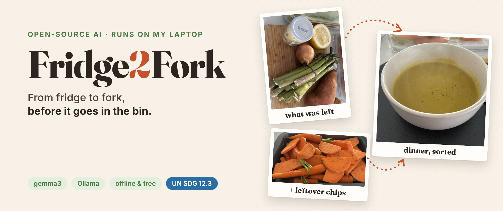

# 🥕 Fridge2Fork

*From fridge to fork, before it goes in the bin.*

Type in what's in your fridge, tick what's in your spice rack and cupboard, and a **local open-weight AI** suggests recipes that use it up. Nothing leaves your computer.

Built for the [DEV Hacktoberfest 2026 Open-Source AI Challenge, Week 2: "Side Hustle"](https://dev.to/challenges/hacktoberfest-week2-2026-10-12).

## Features

- **Fridge → recipes:** one idea at a time (🔄 for another), each with time, ingredients it uses up, anything extra you'd need, and steps
- **Your own recipes first:** if you can nearly make a saved recipe ("you have 6 of 7"), that's the first idea, adapted to what's missing. It knows a shallot will do for an onion.
- **🥗 A side from the leftovers:** whatever your main doesn't use becomes a side, like soup **and** roasted veg chips
- **Rescue dishes** for soft or ageing veg: cottage pie with a mash topping from almost any root veg or cauliflower, veggie ragù, fritters, soups
- **Kind of dish:** surprise me, or ask for a soup, curry, cottage pie…
- **🧂 Spices and 🥫 Cupboard** checklists in the toolbar, plus add your own (remembered in your browser)
- **Meal** (breakfast / lunch / dinner / snack), **cuisine**, **diet**, **max time** and **servings**
- **🏠 Home cook** or **☕ Cafe special** mode: turn stock that's about to go off into a sellable special
- **📖 My recipes:** save suggestions you love, or add family favourites. The model adapts them to what's in the fridge ("Based on your lasagne, minus the ricotta"). They're stored in `recipes.json`.
- **Import from the web:** paste a recipe link and it reads the page's schema.org recipe card (instant), or paste the recipe text and gemma3 pulls out just the recipe. You check the result before saving, and it keeps a 🔗 link to the original.
- **📄 Save as PDF** on any recipe, to share or print
- **❄️ Extra to freeze:** cook extra portions for lunches or another dinner; every recipe says whether it freezes and how, and what the frozen meals save you
- **🛒 On a budget:** type reduced "eat today" specials with prices and a budget; each recipe shows what to buy and what it costs (worked out in code, not by the model)

## Run it

You need [Ollama](https://ollama.com) and Python 3. There's nothing to `pip install`.

```
ollama pull gemma3
python3 app.py
```

Then open http://localhost:8000. On a laptop CPU (7 GB RAM, no GPU), the first idea takes about a minute.

<p align="center">
  
  <br>
  <em>A snapshot of the app, version 1.0</em>
</p>

<p align="center">
  
  <br>
  <em>A snapshot of a printed recipe</em>
</p>

    
  To try a different open model:

```
MODEL=llama3.2 python3 app.py
```

`PORT=8080` changes the port.

## How it works

- `app.py` is a small standard-library Python server. It turns the form into a prompt, asks **gemma3** through Ollama for JSON, validates it (retrying broken replies) and removes anything from "also need" that you already have.
- **The code makes the decisions, the model writes the recipe.** The code picks the style of dish, matches your saved recipes, works out the leftovers for a side, checks you have the base a dish needs (no risotto without rice), and adds up prices. A small model is a good writer but a poor decider.
- Saved recipes live in `recipes.json` (created on first save), with automatic backups in `backups/`.
- `index.html` is one page with no frameworks or build step.

## License

MIT
